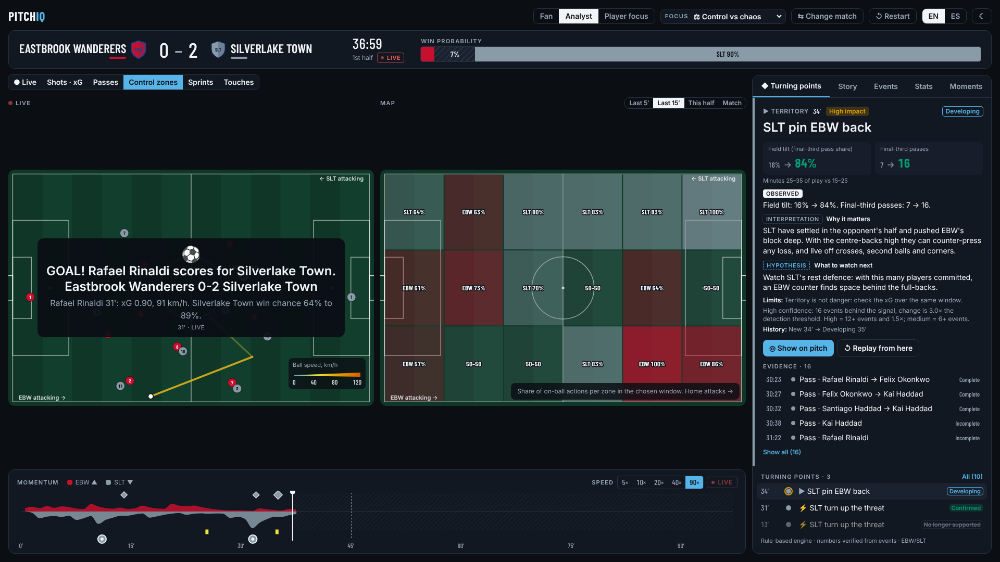
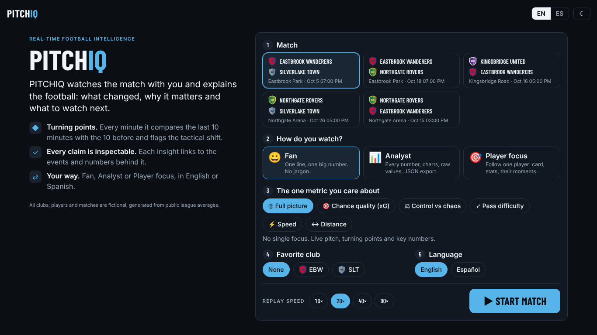
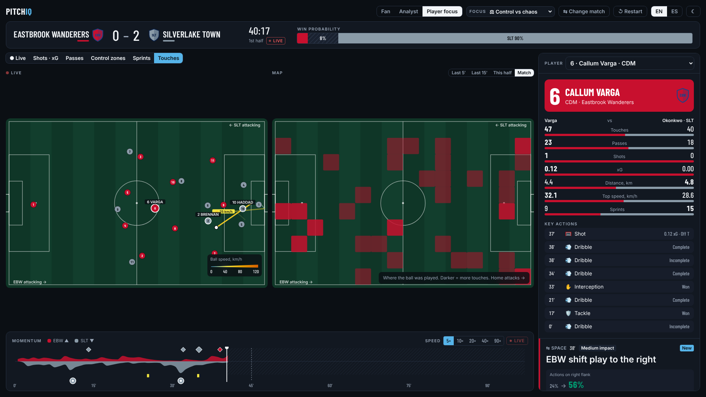
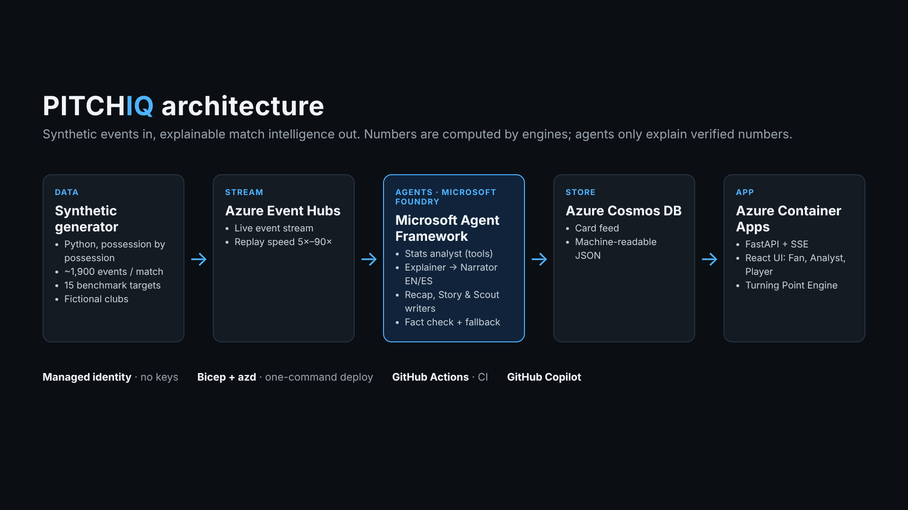

# PITCHIQ

**Real-time football intelligence from synthetic match events: what changed, why it matters and what to watch next.**

Built for the Microsoft football AI hackathon.

- **Live demo:** https://ca-matchcopilot-thfqhhiyefk5q.wittysmoke-635db452.eastus2.azurecontainerapps.io/
- **Submission kit** (description, video script, testing steps): [`docs/SUBMISSION.md`](docs/SUBMISSION.md)
- **All data is synthetic.** Clubs, players and matches are fictional, generated by our own engine. No third-party event data is used or shipped.



## Try it in 1 minute

1. Open the [live demo](https://ca-matchcopilot-thfqhhiyefk5q.wittysmoke-635db452.eastus2.azurecontainerapps.io/).
2. Pick a match, a mode (Fan, Analyst or Player focus) and press **Start match**.
3. In Analyst mode, open a turning point and press **Show on pitch**. On the Story tab, press **Write it** for the AI match story.
4. Switch to **ES** for Latin American Spanish, or change the replay speed during the match.

| Landing | Player focus |
| --- | --- |
|  |  |



## What it does

| Part | Where |
| --- | --- |
| Synthetic match generator (~1,900 events per match, 15 benchmark targets) | `src/matchcopilot/generator` |
| Metrics engine: xG, pass difficulty, control index, win probability, key moments | `src/matchcopilot/metrics`, `frontend/src/stats` |
| Tactical Turning Point Engine: 8 signals, confidence, lifecycle, evidence links | `frontend/src/stats/turning.ts` |
| Agent crew (Microsoft Agent Framework on Foundry): stats analyst, explainer, narrator EN/ES, recap writer | `src/matchcopilot/agents/crew.py` |
| AI match story and AI player report: story and scout writers, fact-checked | `src/matchcopilot/agents/writers.py` |
| Live API (FastAPI, Server-Sent Events) and React UI: Fan, Analyst, Player focus; EN/ES | `src/matchcopilot/api`, `frontend/` |
| Azure infra (Bicep + azd): Container Apps, Event Hubs, Cosmos DB, managed identity | `infra/` |

## Frontend (React)

`frontend/` is the PITCHIQ app, served by FastAPI at `/` (the first UI stays at `/classic`).
React, TypeScript, Tailwind, D3, Recharts and Framer Motion. Design notes: `frontend/DESIGN.md`.

```powershell
cd frontend
npm install
npm run dev        # proxies /api to the FastAPI server on :8000
```

## Architecture

```
synthetic generator ──> Azure Event Hubs ──> MatchSession (Container Apps)
                                               │  metrics engine: xG, pass difficulty, control index, win probability
                                               │  template card (EN/ES) published instantly
                                               └─> agent crew (Microsoft Agent Framework on Foundry models)
                                                     stats analyst (tools) -> explainer -> narrator EN/ES
                                                     recap writer at HT/FT, shared moment log, fact check, fallback
                                                   ──> upgraded card (same id, version 2)
browser engines (stats, turning points) ──> facts ──> story writer / scout writer (Foundry) ──> fact check ──> AI story, player report
cards ──> Azure Cosmos DB (feed)    cards ──> personalizer ──> SSE per viewer ──> overlay web UI
```

## Synthetic data

`matchcopilot.generator` simulates a full 90-minute match possession by possession. Every
action (pass, carry, dribble, shot) is sampled from zone, pressure, team quality and a latent
momentum process (Ornstein-Uhlenbeck), so control swings back and forth like a real match.
All clubs and players are fictional. No third-party event data is used or shipped.

One match is about 1,900 events: passes, carries, dribbles, pressures, tackles,
interceptions, ball recoveries, shots, goalkeeper actions, fouls, cards, substitutions and
a physical update every 60 seconds (distance, top speed and sprints for all 22 players).
Events carry ball speed, shot speed and player speed for the speed metrics.

Coordinates use a 120 x 80 pitch in the acting team's frame (it attacks towards x = 120).
Distances are in metres, speeds in km/h. See `src/matchcopilot/generator/schema.py`.

### Realism check

`matchgen validate` averages 40 matches and checks them against realistic top-flight
ranges in `src/matchcopilot/data/priors.json`:

| Metric (per match) | Synthetic mean | Target range |
| --- | --- | --- |
| Passes | 1,023 | 800 to 1,100 |
| Pass completion | 82.8% | 76% to 86% |
| Shots | 23.4 | 18 to 32 |
| Shots on target | 40.5% | 28% to 42% |
| Goals | 2.85 | 2.2 to 3.3 |
| xG per shot | 0.105 | 0.08 to 0.14 |
| Pressures | 336 | 220 to 380 |
| Tackles | 36.1 | 22 to 45 |
| Fouls | 21.7 | 16 to 28 |
| Outfield distance (90 min) | 10.8 km | 9.0 to 12.5 km |

## Run the app locally

Needs Python 3.11+ and Node 22. Build the React app once, then start the API (it serves the UI at `/`).

```powershell
# Windows PowerShell
python -m venv .venv; .venv\Scripts\Activate.ps1
pip install -e ".[dev,azure]"
cd frontend; npm ci; npm run build; cd ..
az login                                               # the agents use your Azure login
$env:FOUNDRY_PROJECT_ENDPOINT = "https://<resource>.services.ai.azure.com/api/projects/<project>"
$env:FOUNDRY_MODEL = "<your model deployment name>"
uvicorn matchcopilot.api.app:app --port 8000           # open http://localhost:8000
```

```bash
# macOS / Linux
python -m venv .venv && source .venv/bin/activate
pip install -e ".[dev,azure]"
(cd frontend && npm ci && npm run build)
az login
export FOUNDRY_PROJECT_ENDPOINT="https://<resource>.services.ai.azure.com/api/projects/<project>"
export FOUNDRY_MODEL="<your model deployment name>"
uvicorn matchcopilot.api.app:app --port 8000
```

Without the two Foundry variables the app runs in template mode: every card still appears,
in EN and ES, without the AI agents. `docker compose up --build` also runs template mode.

## Generator and tests

```bash
pip install -e ".[dev]"
matchgen generate --seed 7 --matches 3 --out data/samples
matchgen replay data/samples/SYN-000007-EBW-SLT.events.jsonl --speed 30
matchgen validate --matches 40    # realism check against priors.json
pytest -q                         # generator, metrics, agents (fallbacks), API, sources
cd frontend && npm run build      # type-check and build the React app
```

CI (GitHub Actions) runs `pytest`, `matchgen validate --matches 40` and the frontend build on every pull request.

## Repository layout

| Path | What |
| --- | --- |
| `src/matchcopilot/generator` | Synthetic match generator, schema, realism validator, `matchgen` CLI |
| `src/matchcopilot/metrics` | xG, pass difficulty, control index, win probability, key moments |
| `src/matchcopilot/agents` | Agent crew and AI writers (Microsoft Agent Framework on Foundry) |
| `src/matchcopilot/narration` | Template cards (EN/ES) and per-viewer personalization |
| `src/matchcopilot/api` | FastAPI app, SSE stream, Event Hubs and Cosmos DB adapters |
| `frontend/` | PITCHIQ React app; `web/` is the first UI, kept at `/classic` |
| `data/samples` | Three generated matches (seeds 7 to 9) |
| `infra/`, `azure.yaml` | Bicep and azd deployment |
| `tests/` | pytest suite |
| `docs/` | Submission kit and images |

## Deploy to Azure

Needs the Azure CLI, the Azure Developer CLI (`azd`) and Docker.

```bash
az login && azd auth login
azd env new match-copilot
azd env set FOUNDRY_PROJECT_ENDPOINT "https://<resource>.services.ai.azure.com/api/projects/<project>"
azd env set FOUNDRY_MODEL "<your model deployment name>"
azd up                      # creates the resource group, builds the image, deploys

# let the app's managed identity call your Foundry models
az role assignment create --role "Azure AI User" \
  --assignee "$(azd env get-value AZURE_MANAGED_IDENTITY_PRINCIPAL_ID)" \
  --scope "<resource id of your Foundry resource>"
```

`azd up` prints the app URL. To delete everything after judging: `azd down --purge`.

## License

MIT
