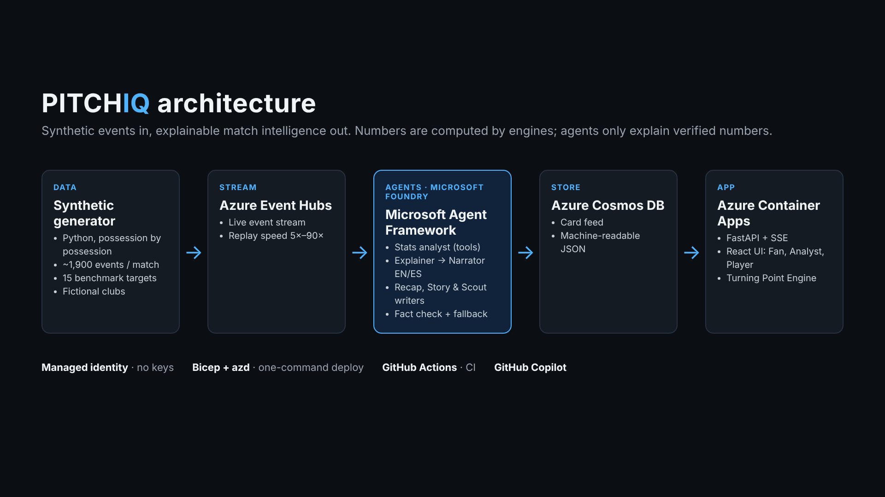

# PITCHIQ on Azure (deployment record)

PITCHIQ ran live on Azure from **Oct 25 to Nov 2026** (region East US 2, one resource group).
The deployment was then deleted to stop costs. Everything below is reproducible from this repo:
`azd up` recreates it in one command (see the main [README](../../README.md#deploy-to-azure)).

## Resources

All created by `infra/resources.bicep` except the Foundry resource, which was created in the Foundry portal and passed in as two settings.

| Resource | Azure service | Configuration | Role in the pipeline |
| --- | --- | --- | --- |
| `ca-matchcopilot-*` | Container Apps | 1 vCPU, 2 GiB, 1 replica, HTTPS ingress | FastAPI app: match sessions, metrics engine, agents, SSE stream, React UI |
| `cae-matchcopilot-*` | Container Apps environment | Consumption | Hosts the app, sends logs to Log Analytics |
| `evh-matchcopilot-*` | Event Hubs | Basic tier, 1 hub, 2 partitions, 1-day retention | Event stream: the generator publishes every match event here |
| `cosmos-matchcopilot-*` | Cosmos DB (NoSQL) | Serverless, database `matchcopilot`, container `cards` | Feed of every insight card (template and AI-upgraded versions) |
| `crmatchcopilot*` | Container Registry | Basic | Holds the app image built by `azd deploy` |
| `id-matchcopilot-*` | User-assigned managed identity | AcrPull, Event Hubs Data Owner, Cosmos DB Data Contributor, Azure AI User | One identity, no keys or connection strings anywhere |
| `log-matchcopilot-*` | Log Analytics | Pay as you go | App logs, agent fallbacks, writer failures |
| `nicolastamara2000-hacka-resource` | Microsoft Foundry | Model deployment `gpt-5-mini`, project `nicolastamara2000-hackathon` | Agent crew (stats analyst, explainer, narrator, recap writer) and the story and scout writers, via Microsoft Agent Framework |

## Data flow

1. `MatchSession` starts a broadcast: the synthetic generator publishes events to **Event Hubs** at the chosen replay speed.
2. The app consumes the hub, runs the metrics engine (xG, pass difficulty, control index, win probability) and publishes a template card in EN and ES at once.
3. Key moments go to the **agent crew on Foundry**. Its card replaces the template card (same id, version 2) only if it passes the fact check; a slow or failed call keeps the template card.
4. Every card is written to **Cosmos DB** and streamed to each viewer over Server-Sent Events, personalised by mode, team, player and language.
5. In the browser, the TypeScript engines compute turning points and match facts; the **Foundry writers** turn those facts into the AI match story and player reports, fact-checked on the server.

## Screenshots

Taken from the Azure portal before deletion.

| | |
| --- | --- |
| Resource group with every resource |  |
| Container App overview (URL, replica, image) |  |
| Container App log stream during a live match |  |
| Event Hubs metrics: incoming messages during a match |  |
| Cosmos DB Data Explorer: one card document |  |
| Foundry: the `gpt-5-mini` model deployment |  |
| Managed identity role assignments |  |
| Cost analysis for the resource group |  |

## Lessons learned

- **Free subscriptions block ACR Tasks**, so `azd` remote builds fail. Building the image locally with Docker Desktop and `azd deploy` works.
- **One replica on purpose.** Live broadcasts are held in memory and shared by every viewer; scaling out would need the session state in Cosmos DB or Redis first.
- **AI never blocks the broadcast.** Template cards appear instantly; the agent's version replaces them only after a fact check. This kept the demo working through model timeouts.
- **Managed identity everywhere** removed every secret from the app settings and the repo.
